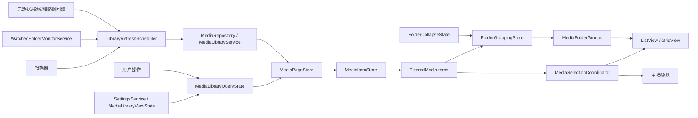

# 媒体库界面架构问题与优化方案

更新日期：2026-06-07

## 目的

这份文档记录对媒体库功能和界面代码的架构审查结论，并给出可分阶段落地的优化方案。重点解决近期暴露的几个问题：

- 媒体库界面闪烁。
- 切换媒体偶发失灵。
- 删除当前播放媒体后切换到下一个媒体偏慢。
- 大文件夹扫描耗时长，且扫描状态可能卡住。
- 按文件夹显示时，父子文件夹层级、缩进和折叠状态不稳定。
- 软件启动后希望恢复上次的媒体库/播放区比例与媒体库浏览设置。
- 不希望为了标签或媒体身份额外生成 sidecar JSON 文件。

优化目标不是重写媒体库，而是把现有代码拆成职责清晰、状态来源明确、可验证的模块，让后续功能可以继续迭代。

## 审查范围

主要审查对象：

- `LibraryShellViewModel`
- `MediaBrowserController`
- `MainPageShellController`
- `IncrementalMediaCollection`
- `MediaFolderGroupViewModel`
- `MediaLibraryService`
- `MediaRepository`
- `MediaTagRepository`
- `SettingsService`
- 媒体库相关 XAML 资源与 grouped view 绑定

当前代码已经具备分页加载、文件夹分组、文件系统监听、后台元数据更新、标签、播放列表、独立播放窗口等能力。但这些能力之间的状态边界偏模糊，导致一个局部改动容易牵动选择、播放、刷新和分组。

## 代码热点

以下文件是后续优化最容易产生连锁反应的位置，改动时需要优先审查：

- `src/JvJvMediaManager.WinUI/ViewModels/MainPage/LibraryShellViewModel.cs`
  - 当前承担查询、分页、分组、扫描、watcher、设置持久化等多种职责，是媒体库状态复杂度最高的位置。
- `src/JvJvMediaManager.WinUI/Controllers/MainPage/MediaBrowserController.cs`
  - 负责 ListView/GridView 选择同步、滚动加载、右键目标等 UI 行为，是切换失灵和 transient empty selection 的高风险区。
- `src/JvJvMediaManager.WinUI/ViewModels/IncrementalMediaCollection.cs`
  - 决定 UI 集合是增量变更还是 Reset，是闪烁和滚动位置稳定性的关键点。
- `src/JvJvMediaManager.WinUI/ViewModels/MediaFolderGroupViewModel.cs`
  - 承载文件夹分组、缩进、折叠状态和 VisibleItems，是“按文件夹显示”体验的核心。
- `src/JvJvMediaManager.WinUI/Views/MainPage/MediaLibraryResources.xaml`
  - folder header、group style、item template 都在这里，XAML 绑定方式会直接影响缩进和重绘稳定性。
- `src/JvJvMediaManager.WinUI/Services/MediaLibraryService.cs`
  - 控制扫描、导入、元数据更新和数据库写入节奏，是启动慢和扫描久的主要路径。
- `src/JvJvMediaManager.WinUI/Data/MediaRepository.cs`
  - 查询、分页、搜索、排序和路径匹配都依赖它，必须避免返回重复记录或不稳定排序。
- `src/JvJvMediaManager.WinUI/Services/SettingsService.cs`
  - 后续浏览设置、布局比例、折叠状态都应通过它集中持久化，并避免频繁同步写磁盘。

落地约束：

- 每个阶段完成后必须能单独构建。
- 优先修复状态流和集合更新方式，再调整视觉样式。
- 不通过额外 sidecar JSON 保存标签。
- 不把标签默认写入媒体文件本体。
- 独立窗口可以复用主播放器组件，但不能反向污染主窗口选择、播放列表和浏览状态。

## 问题清单

### P0-1. 媒体对象身份不稳定会导致切换失灵

媒体库中同一个媒体记录会在多个地方出现：

- `FilteredMediaItems`
- `MediaFolderGroups -> VisibleItems`
- ListView/GridView 选中项
- 播放器当前媒体
- 右键菜单选中项
- 删除工作流中的候选项

这些地方必须引用同一个 `MediaItemViewModel` 实例，或者至少通过稳定 ID 做统一解析。如果文件夹分组或刷新过程重新创建了媒体对象，以下逻辑会变脆：

- `FilteredMediaItems.IndexOf(selectedMedia)`
- 上一个/下一个媒体计算
- 删除当前播放媒体后的替代选择
- ListView/GridView selected item 同步
- 多选右键菜单目标解析

这就是“界面看起来选中了，但播放器不切换”或“切换媒体失灵”的核心风险。

### P0-2. 选择状态来源过多

当前选择状态分布在多个位置：

- `LibraryShellViewModel.SelectedMedia`
- `SelectionViewModel.SelectedMedia`
- `MediaBrowserController` 内部 selected id 集合
- `ListView.SelectedItems`
- `GridView.SelectedItems`
- `MediaItemViewModel.IsSelected`
- 播放器当前 active media

这些状态需要互相同步，还要处理刷新、分页、折叠文件夹、视图切换、删除媒体时产生的短暂无选择状态。因此 `MediaBrowserController` 中出现了大量 suppression、deferred sync、visibility verification 逻辑。

风险：

- 一次集合刷新可能误触发空选择，把播放器当前媒体清掉。
- ListView/GridView 双视图切换时可能互相递归触发 selection changed。
- 新增功能如果直接写 `IsSelected` 或 `SelectedMedia`，容易绕过同步保护。

### P0-3. grouped view 收到 Reset 或大批量替换时容易闪烁

媒体库 UI 使用 grouped view。WinUI grouped ListView/GridView 对集合 `Reset`、全量 Clear/Add、大规模对象替换非常敏感。只要分组或可见项被整体替换，界面就可能出现：

- 整屏闪烁。
- 滚动位置跳动。
- 当前选中项短暂消失。
- 缩略图重新加载。
- 选择恢复逻辑被迫介入。

这也是“媒体库界面一直闪”的主要架构原因。

### P0-4. 刷新入口太多，后台事件容易打扰 UI

媒体库刷新可能来自：

- 用户搜索、排序、筛选。
- 播放列表切换。
- watched folder 设置变化。
- 手动扫描。
- 增量扫描进度。
- 扫描完成。
- `FileSystemWatcher` 文件变化。
- 后台元数据、指纹、缩略图回填。
- 删除媒体。

如果这些入口直接调用完整刷新或 loaded window 刷新，就会造成刷新风暴。用户操作和后台事件没有统一优先级时，UI 很容易被后台变化打断。

风险：

- 大量文件变化时持续闪烁。
- 扫描状态和刷新状态混在一起，出现“正在扫描 1 个媒体”长时间不结束。
- 后台 metadata 更新导致当前播放或当前选择被扰动。

### P1-1. `LibraryShellViewModel` 职责过重

`LibraryShellViewModel` 同时承担：

- 查询状态。
- 分页加载。
- 文件夹分组。
- 扫描状态。
- 文件系统监听。
- 设置持久化。
- 选择状态暴露。
- 缩略图加载入口。
- 播放列表/标签联动。

影响：

- 局部功能很难单独验证。
- 修改文件夹树可能影响选择。
- 修改扫描逻辑可能影响 UI 刷新。
- 添加浏览设置持久化容易继续增加 ViewModel 复杂度。

### P1-2. 文件夹树投影与分页加载耦合

“按文件夹显示”本质上是对当前媒体集合的投影，但当前分组、折叠、分页加载之间存在耦合：

- 分页追加媒体后要重建分组。
- 展开文件夹可能触发加载更多。
- 折叠父文件夹会影响子分组可见性。
- 分组 header 的缩进和显示名依赖路径层级计算。

风险：

- 大库下分组重建成本高。
- 子文件夹缩进、tooltip、折叠状态容易互相影响。
- 文件夹 header 显示完整路径时，视觉上看不出层级。

### P1-3. 删除当前播放媒体后的切换路径偏重

删除当前播放媒体后，理想路径应该是：

1. 先确定下一个候选媒体 ID。
2. 从 UI 集合中增量移除已删媒体。
3. 立即切换播放器到候选媒体。
4. 后台再做数据库清理、缩略图清理、分组摘要刷新。

如果删除流程等待完整刷新、分组重建或文件系统确认完成后再切换，就会让用户感觉“切换到下一个媒体很慢”。

### P1-4. 启动和扫描缺少“先显示缓存，再后台校验”的明确策略

Windows 自带照片和媒体播放器通常不需要每次完整扫描，是因为它们更多依赖：

- 系统索引。
- 文件夹已知库。
- 已缓存的缩略图和属性。
- 按需枚举，而不是启动即全量建库。

本项目有自己的媒体库数据库和标签体系，因此不能完全依赖系统播放器行为。但可以采用同样的体验策略：

- 启动时先读本地数据库快照。
- 立即显示已知媒体。
- 后台再增量校验新增、删除、移动、改名。
- 只有用户手动要求或数据库版本不兼容时才做完整扫描。

### P1-5. 标签和媒体身份不能只依赖路径

用户已经关心“加了标签的媒体移动位置或改名后标签还在吗”。如果媒体 ID 或标签关联只依赖绝对路径，那么移动/改名会导致标签丢失。

更稳的方案：

- 数据库中保存内容指纹、文件大小、修改时间、路径历史。
- 文件移动/改名后，用指纹或弱指纹匹配原记录。
- 标签仍保存在应用数据库中，不额外生成 JSON sidecar。

不建议默认把标签写进媒体文件本体：

- 图片/视频格式差异大。
- 写入元数据可能破坏文件时间戳或兼容性。
- 视频容器写标签风险更高。
- 需要复杂的失败回滚。

### P2-1. 浏览设置和布局状态应独立建模

用户希望恢复：

- 媒体库窗口和播放窗口比例。
- 媒体库视图模式。
- 排序字段和顺序。
- 筛选条件。
- 文件夹显示模式。
- 文件夹折叠状态。
- 图标大小、面板宽度等浏览偏好。

这些设置不应散落在 ViewModel 属性 setter 中直接保存。应有单独的 `MediaLibraryViewState`，由设置服务统一加载、应用、节流保存。

### P2-2. 诊断日志缺少统一指标口径

当前已经有 `AppTraceLogger`，但要判断优化是否有效，需要统一记录：

- 刷新来源。
- 刷新类型。
- debounce 等待时间。
- 查询耗时。
- 首屏加载耗时。
- loaded window diff 数量。
- 文件夹分组 diff 数量。
- 删除到下一媒体可播放的耗时。
- 扫描状态开始/完成/取消。

否则“变快了”或“还在闪”只能靠肉眼感受，难以定位下一步。

## 优化原则

- 媒体 ID 是逻辑身份，`MediaItemViewModel` 实例是 UI 身份。
- `FilteredMediaItems` 是当前已加载媒体对象的唯一来源。
- 文件夹分组只做投影，不创建媒体对象副本。
- 选择状态只能有一个逻辑来源，ListView/GridView 是同步目标。
- 后台扫描、watcher、metadata 回填不能直接冲击 UI 集合，必须进入刷新调度器。
- 尽量使用增量 Add/Remove/Move/Replace，避免 `Reset`。
- 启动优先显示数据库缓存，再后台增量校验。
- 标签和媒体身份保存在数据库，不默认生成额外 sidecar 文件。
- 每个阶段都必须可构建、可手动回归。

## 目标架构

模块职责：

- `MediaLibraryQueryState`：描述当前查询条件，不直接刷新 UI。
- `MediaPageStore`：负责分页、刷新当前窗口、加载更多页。
- `MediaItemStore`：保证同一个媒体 ID 复用同一个 `MediaItemViewModel`。
- `FolderGroupingStore`：把已加载媒体和文件夹摘要投影成分组。
- `MediaSelectionCoordinator`：统一管理单选、多选、视图同步和 transient empty selection。
- `LibraryRefreshScheduler`：合并后台刷新请求，控制 debounce 和优先级。
- `WatchedFolderMonitorService`：只负责监听文件变化并产生批次事件。
- `MediaLibraryViewState`：负责浏览设置和布局状态的加载、应用、保存。

## 分阶段优化方案

### Phase 0: 建立诊断基线

目标：先让问题可观察，避免优化后无法判断是否有效。

改动：

- 给以下路径增加统一日志：
  - 应用启动到媒体库首屏显示。
  - `RefreshMediaAsync` / loaded window refresh。
  - 加载下一页。
  - 文件夹分组重建。
  - ListView/GridView selection changed。
  - 删除当前播放媒体到新媒体开始加载。
  - 扫描开始、增量、完成、取消。
  - watcher 批次合并。
- 日志字段至少包括：
  - `Source`
  - `RefreshType`
  - `ElapsedMs`
  - `LoadedCount`
  - `Inserted/Removed/Moved/Replaced`
  - `SelectedId`
  - `Generation`

验收：

- 能从日志判断一次闪烁由哪个刷新源触发。
- 能从日志判断切换失灵时 selected id 是否还在 loaded items 中。
- 能从日志判断扫描状态卡住在哪个阶段。

### Phase 1: 稳定媒体对象身份

目标：先稳住切换、选择、删除后切换。

改动：

- 新增 `MediaItemStore`。
- 所有媒体查询结果进入 UI 前统一调用 `GetOrUpdate(media)`。
- `IncrementalMediaCollection` 支持注入 item factory。
- `FilteredMediaItems`、文件夹分组 `VisibleItems`、播放器选择都引用 store 返回的对象。
- 删除媒体时从 store 移除对应 ID。
- 在代码注释或类型边界中明确：分组层不能创建媒体对象副本。

验收：

- 列表点击、网格点击、上一项、下一项都稳定切换。
- 删除当前媒体后能快速切换到替代媒体。
- 刷新当前窗口后当前媒体不因对象替换丢失。
- 同一个媒体在分组和主列表中引用一致。

风险：

- 如果仍有入口直接 `new MediaItemViewModel`，问题会以偶发方式继续出现。

### Phase 2: 抽离选择协调器

目标：减少 `MediaBrowserController` 中分散的选择同步逻辑。

改动：

- 新增 `MediaSelectionCoordinator`，统一管理：
  - 主选中媒体 ID。
  - 多选媒体 ID 集合。
  - `IsSelected` 批量更新。
  - ListView/GridView selection sync。
  - 集合刷新期间的 suppression scope。
  - transient empty selection 判断。
- `LibraryShellViewModel.SelectedMedia` 只作为薄封装或只读状态暴露。
- Controller 中所有直接写选择状态的入口改为调用 coordinator。

验收：

- 列表/网格切换视图后选择保持。
- 多选右键菜单目标正确。
- 折叠包含当前媒体的文件夹时，播放器不被清空。
- 搜索、排序、分页加载时不会产生错误空选择。

风险：

- 不要一次性删除已有 suppression 逻辑。应先迁移状态，再收敛重复判断。

### Phase 3: 拆分查询与分页

目标：让搜索、排序、筛选、分页变成可预测的数据流。

改动：

- 新增 `MediaLibraryQueryState`，包含：
  - 搜索词。
  - 媒体类型。
  - 标签过滤。
  - 播放列表。
  - 排序字段和顺序。
  - 可见/隐藏 watched folders。
- 新增 `MediaPageStore`，负责：
  - `RefreshAsync(query, preserveSelectionId)`
  - `LoadNextPageAsync()`
  - `RefreshLoadedWindowAsync()`
  - 当前 query generation 管理。
- `LibraryShellViewModel` 只组装 query state，不直接管理分页细节。
- 快速连续搜索时取消或忽略过期 generation。

验收：

- 搜索、排序、类型筛选、播放列表切换结果正确。
- 快速输入搜索不会堆积多个过期刷新。
- 滚动到底部加载下一页稳定。
- 后台刷新不会大幅打乱滚动位置。

风险：

- page store 必须保存当前 query，否则 load next page 可能使用过期条件。

### Phase 4: 文件夹分组改为纯投影和 diff 更新

目标：解决按文件夹显示闪烁和层级不稳定。

改动：

- 新增 `FolderGroupingStore`：
  - 输入：已加载媒体、文件夹摘要、折叠状态、可见根目录。
  - 输出：稳定 path key 的 folder groups。
- `MediaFolderGroupViewModel.VisibleItems` 使用 item ID diff 更新。
- `MediaFolderGroups` 使用 folder path key diff 更新。
- 不再对 grouped view 做全量 Clear/Add。
- header 主文本显示当前文件夹名。
- tooltip 显示完整路径。
- 子文件夹缩进用固定 spacer width 绑定，不绑定 `ColumnDefinition.Width`。
- 父文件夹折叠状态和子分组可见性分开建模。

验收：

- 父文件夹 header 靠左。
- 一级/二级/三级子文件夹逐级缩进。
- 折叠父文件夹后子文件夹隐藏。
- 展开父文件夹后子文件夹恢复。
- 分页追加时只更新受影响分组，界面不整屏闪。

风险：

- 分组 key 必须使用规范化 folder path，不能用显示名。

### Phase 5: 统一刷新调度和 watcher 服务

目标：后台事件不直接打断 UI。

改动：

- 新增 `LibraryRefreshScheduler`。
- 刷新类型：
  - `FullRefresh`
  - `LoadedWindowRefresh`
  - `FolderSummaryRefresh`
  - `BackgroundMetadataRefresh`
- 刷新来源：
  - `UserFilter`
  - `WatchedFolderSettings`
  - `FolderWatcher`
  - `BackgroundMetadata`
  - `ScanIncremental`
  - `ScanFinalize`
  - `ManualRefresh`
- 对后台来源做 debounce，对用户来源给更高优先级。
- 新增 `WatchedFolderMonitorService`，只负责合并 `FileSystemWatcher` 事件。
- 扫描流程只更新扫描状态和数据库，UI 刷新统一排队。

验收：

- 大量文件变化时 UI 不持续闪。
- watcher 多个事件合并成少量刷新。
- 扫描状态不会卡在“正在扫描 1 个媒体”。
- 后台 metadata/fingerprint 更新不影响当前播放。

风险：

- debounce 时间过短会继续闪，过长会让新增文件出现太慢。

### Phase 6: 启动和扫描改为缓存优先

目标：避免每次打开软件都必须重新扫描完整文件夹。

改动：

- 启动时优先读取数据库中已知媒体，立即显示首屏。
- 后台执行轻量校验：
  - watched folder 是否存在。
  - 文件数量和最近修改时间是否明显变化。
  - 上次扫描是否中断。
  - 数据库 schema 是否需要迁移。
- 只有以下情况触发完整扫描：
  - 用户手动扫描。
  - 新增 watched folder。
  - 数据库版本变更需要重建派生信息。
  - 检测到缓存明显不可信。
- 对大文件夹使用分批扫描：
  - 先发现路径。
  - 再补元数据。
  - 再补缩略图/指纹。
- 尽量复用 Windows 已有信息：
  - 文件系统枚举提供大小和修改时间。
  - Windows property system 可作为元数据补充来源。
  - 系统缩略图缓存可作为未来优化方向。
- 不依赖 Windows 索引作为唯一数据源，因为本应用还需要标签、播放列表、隐藏文件夹、指纹和自定义排序。

验收：

- 已扫描过的库再次启动时能快速显示缓存媒体。
- 后台扫描不会阻塞首屏交互。
- 手动扫描仍能发现新增、删除、移动、改名。
- 大量媒体的扫描进度能持续推进并正确结束。

风险：

- 数据库缓存需要有可信度判断，不能因为跳过扫描而长期显示不存在的文件。

### Phase 7: 媒体身份、标签和无 sidecar 存储

目标：移动或改名后尽量保留标签，同时不生成额外 JSON 文件。

改动：

- 标签继续保存在应用数据库。
- 媒体记录增加或完善身份字段：
  - `Id`
  - 当前路径。
  - 文件名。
  - 文件大小。
  - 修改时间。
  - 内容指纹。
  - 弱指纹。
  - 路径历史。
- 扫描发现新路径时，匹配顺序：
  1. 当前路径完全匹配。
  2. 路径历史匹配。
  3. 强内容指纹匹配。
  4. 文件大小 + 修改时间 + 弱指纹匹配。
  5. 无法匹配时创建新媒体记录。
- 匹配成功后更新路径，不改变媒体 ID，因此标签继续保留。

验收：

- 文件在 watched folder 内改名后标签仍在。
- 文件移动到另一个 watched folder 后标签仍在。
- 文件内容改变后不会错误继承旧标签。
- 不生成 `.json` sidecar 文件。

风险：

- 大视频计算强指纹可能耗时，应优先使用分块指纹或后台补全。

### Phase 8: 浏览设置和布局状态持久化

目标：恢复用户上次的媒体库浏览环境。

改动：

- 新增 `MediaLibraryViewState`，集中保存：
  - 主窗口大小和位置。
  - 媒体库/播放区 SplitView 或 Grid 比例。
  - 媒体库面板宽度。
  - 列表/网格/文件夹视图模式。
  - 排序字段和顺序。
  - 媒体类型筛选。
  - 图标大小。
  - 是否按文件夹显示。
  - 折叠的文件夹 path keys。
  - 最近搜索词是否保留由产品决策决定，默认不保留。
- ViewModel 启动时一次性应用 view state。
- 用户调整时节流保存，避免拖动比例时频繁写设置文件。
- 设置加载失败时使用默认值并记录日志。

验收：

- 关闭并重新打开软件后，媒体库/播放区比例恢复。
- 媒体库浏览模式、排序、图标大小恢复。
- 文件夹折叠状态恢复。
- 设置文件损坏时应用仍能启动。

风险：

- 不要在每个属性 setter 中立即同步写文件，应统一 debounce 保存。

## 实施顺序

建议顺序：

1. Phase 0：先补诊断。
2. Phase 1：稳定媒体对象身份。
3. Phase 2：统一选择协调。
4. Phase 3：拆分查询和分页。
5. Phase 4：文件夹分组 diff。
6. Phase 5：刷新调度和 watcher。
7. Phase 6：缓存优先启动和扫描优化。
8. Phase 7：媒体身份和标签保留。
9. Phase 8：浏览设置和布局状态持久化。

如果只能先做一小部分，优先做 Phase 1 和 Phase 2。它们直接影响切换媒体、删除后切换、多选和右键菜单，是后续优化的地基。

## 回归测试清单

### 选择和播放

- 单击列表媒体，播放器切换到对应媒体。
- 单击网格媒体，播放器切换到对应媒体。
- 使用上一项/下一项切换媒体。
- 切换列表/网格视图后，当前选择仍高亮。
- 多选后右键菜单操作目标正确。
- 折叠包含当前媒体的文件夹时，播放器不被误清空。

### 删除

- 删除当前播放媒体后，快速切到下一个可播放媒体。
- 删除多个媒体后，多选状态清理正确。
- 删除文件不存在的媒体时不崩溃，数据库记录被清理。

### 文件夹显示

- 父文件夹 header 靠左。
- 子文件夹 header 自动缩进。
- header 只显示当前文件夹名。
- tooltip 显示完整路径。
- 折叠父文件夹后子文件夹隐藏。
- 展开父文件夹后子文件夹恢复。
- 大量文件夹下滚动不持续闪烁。

### 搜索、排序、筛选

- 搜索后选择媒体，再清空搜索，选择状态合理恢复或清空。
- 快速连续输入搜索不会显示过期结果。
- 排序切换后当前媒体状态合理。
- 播放列表切换结果正确。

### 扫描和 watcher

- 已缓存媒体库启动时不强制完整扫描。
- 手动扫描能发现新增、删除、移动、改名。
- 大量文件扫描时进度持续推进并正确结束。
- watcher 检测连续新增/删除/重命名后，列表最终一致。
- 后台 metadata/fingerprint 更新不影响当前播放。

### 设置持久化

- 重启后媒体库/播放区比例恢复。
- 重启后媒体库视图模式、排序、图标大小恢复。
- 重启后文件夹折叠状态恢复。

## 性能指标

建议至少记录以下指标：

- 应用启动到媒体库首屏可交互耗时。
- 启动后是否触发完整扫描。
- 搜索/排序/筛选首屏刷新耗时。
- 滚动加载下一页耗时。
- 文件夹分组重建耗时。
- 分组 diff 中 inserted/removed/moved/replaced 数量。
- loaded window diff 中 inserted/removed/moved/replaced 数量。
- 删除当前播放媒体到替代媒体开始加载耗时。
- watcher 收到事件数和实际 UI 刷新次数。
- 扫描开始、完成、取消、失败的状态闭环。

## 不建议做的事

- 不建议用重写 UI 样式来解决闪烁。当前根因主要是状态流和集合更新方式。
- 不建议让文件夹分组创建独立 `MediaItemViewModel` 副本。
- 不建议为了省事对 grouped view 做全量 `Reset`。
- 不建议扫描/watcher 直接调用完整刷新。
- 不建议默认生成 sidecar JSON 文件保存标签。
- 不建议默认写入媒体文件本体元数据。
- 不建议在每个设置属性变化时立即同步写入磁盘。

## 完成定义

认为本轮媒体库架构优化完成，需要满足：

- 项目可构建。
- 媒体切换、上一项/下一项、删除后切换稳定。
- 媒体库刷新不再频繁整屏闪烁。
- 文件夹树缩进、折叠、展开稳定。
- 大库启动可先显示缓存数据。
- 扫描状态不会卡住。
- 标签在移动/改名场景下尽量保留。
- 不生成额外 JSON sidecar。
- 浏览设置和主界面比例能跨启动恢复。
- 日志足以定位下一轮性能问题。
